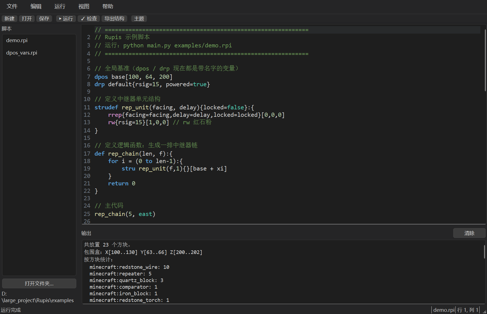

# Rupis

**Rupis**是一门专门为描述《我的世界》Java版本红石结构的脚本语言，它能让你在制作红石机器时不再费力的一个一个搭方块，让你的红石机器被简单，快速的描述。
这个仓库里存下了Rupis解释器和Rupis ide的所有源代码。

**特别注意：目前的Rupis和它的自述文件并不是正式版本，请谨慎使用**

## 零、关于本软件
本软件使用**GNU GENERAL PUBLIC LICENSE**，它的源代码和可执行程序永久免费，如果你发现有非官方渠道正在售卖Rupis程序或源代码，请立即举报并向作者联系。

这个程序目前仅支持在Windows操作系统上运行，不支持Mac和Linux，也不支持Windows 7以下的操作系统。作者大概率不会做兼容其他操作系统的Rupis和Rupis ide。
Rupis目前仅支持java版红石结构，并且大概率不会支持其他版本。

## 一、快速上手
您可以使用以下命令来操作Rupis解释器的可执行程序。
```bash
rupis examples/demo.rpi
rupis examples/demo.rpi --format summary
rupis examples/demo.rpi --format structure -o demo.mcstructure
```

上面三条命令分别表示：

| 命令 | 作用 |
| ---- | ---- |
| `rupis examples/demo.rpi` | 运行脚本，把结果输出成一行一个的 `/setblock` 命令 |
| `rupis examples/demo.rpi --format summary` | 只看统计摘要：一共放了多少方块、包围盒多大、每种方块各多少个 |
| `rupis examples/demo.rpi --format structure -o demo.mcstructure` | 导出 `.mcstructure` 结构方块文件，可以直接丢进存档里加载 |

`examples/` 目录里有三个现成的示例脚本，可以直接改来玩：

| 文件 | 内容 |
| ---- | ---- |
| `examples/demo.rpi` | 语法示范：从简单的放置指令到变量、循环、结构、函数 |
| `examples/kit.rpi` | 一个"零件库"，只放函数和结构，用来演示 `lib` 导入 |
| `examples/lib_demo.rpi` | 演示 `lib` 怎么导入别的脚本、怎么用命名空间调用 |

### 第一次运行

Rupis 第一次运行时会自动做两件事，都只在 Windows 上有效，失败也不影响使用：

1. 在注册表里注册 `.rpi` 文件类型和图标，之后**双击 `.rpi` 文件就能用 Rupis 打开**；
2. 把 Rupis 的安装目录加进当前用户的 `PATH`，这样以后在任意目录下都能直接写 `rupis`。

### 用图形界面

想要边写边看效果，就用自带的 **Rupis IDE**：

```bash
rupis --ide                     # 打开 IDE
rupis --ide examples/demo.rpi   # 打开 IDE 并载入这个脚本
```

直接敲 `rupis`（不带脚本）也会打开 IDE。

### 直接运行源码

不用打包好的可执行程序也能运行，仓库里自带完整源码，只要装了 Python 就能用：

```bash
python main.py examples/demo.rpi          # 等价于 rupis examples/demo.rpi
python main.py --ide                      # 等价于 rupis --ide
python -m rupis examples/demo.rpi         # 也可以用模块的方式运行
python ide.py examples/demo.rpi           # 直接启动 IDE
```

解释器本身**零第三方依赖**，只用 Python 标准库。Rupis IDE 需要额外装一个 Qt 绑定：

```bash
pip install PySide6      # 推荐
pip install PyQt6        # 或者 PyQt6
pip install PyQt5        # PyQt5 也行，代码里做了兼容
```

### 运行出来的结果怎么用

- **`commands` 格式**：把输出的命令整段复制进游戏的聊天栏即可。嫌刷屏的话先执行 `/gamerule commandBlockOutput false`。
- **`structure` 格式**：把 `.mcstructure` 放进存档的 `structures/` 目录，在游戏里用结构方块加载。
- **`json` 格式**：结构化数据，方便你自己再加工或者接到别的工具里。

## 二、命令行参数

| 参数 | 说明 |
| ---- | ---- |
| `脚本.rpi` | 要执行的脚本文件 |
| `--ide` | 启动图形界面 IDE，可以跟一个脚本文件 |
| `-f, --format` | 输出格式：`commands`（默认）/ `json` / `structure` / `summary` |
| `-o, --output` | 输出到文件；不给就打印到标准输出 |
| `--check` | 只做语法检查，不执行脚本 |
| `-v, --verbose` | 执行时把每条放置指令实时打印到标准错误 |
| `--data-version` | `.mcstructure` 的 DataVersion，默认 3955（对应 1.21.4） |
| `--version` | 显示版本号 |

`structure` 格式必须用 `-o` 指定输出文件；其他格式给了 `-o` 就写文件，不给就打印到屏幕上。

## 三、Rupis IDE

自带的图形编辑器，用 Qt 写的（PySide6 / PyQt6 / PyQt5 都能运行，代码里做了兼容层）。



```
┌ 菜单栏 ─────────────────────────────────────────────┐
│ 工具栏：新建 打开 保存 │ ▶运行 ✓检查 导出结构 │ 主题   │
├──────────┬─────────────────────────────────────────┤
│ 脚本列表  │ 查找/替换条（Ctrl+F 时弹出来）             │
│          ├─────────────────────────────────────────┤
│          │ 编辑器（行号 + 语法高亮）                │
│          ├─────────────────────────────────────────┤
│          │ 提示栏（当前关键字 / 元件 / 状态键的说明）   │
│          ├─────────────────────────────────────────┤
│          │ [输出] [控制台] [终端]  ← 标签页切换        │
│          │  运行结果 / 交互式 Rupis / cmd 终端        │
├──────────┴─────────────────────────────────────────┤
│ 状态栏：提示信息 │ 文件名 │ 行:列                      │
└────────────────────────────────────────────────────┘
```

### 功能

| 功能 | 说明 |
| ---- | ---- |
| 语法高亮 | 关键字、元件指令、内置常量、字符串、注释、数字、结构/函数名 |
| 脚本列表 | 左边列出文件夹里的 `.rpi`，**单击直接打开**，当前打开的文件会高亮 |
| 行号槽 | 左边独立绘制，点击行号直接跳过去 |
| 自动缩进 | 回车继承上一行缩进；`{` 之后自动多缩进一级 |
| 整块缩进 | `Tab` / `Shift+Tab` 对选中行批量缩进 / 反缩进 |
| 括号配对 | 输入 `(` `[` `{` 自动补右括号，再按右括号直接跳过 |
| 括号高亮 | 光标贴着的括号会高亮，并配对到另一个（跳过字符串和注释） |
| 批量注释 | `Ctrl+/` 给选中行加 / 去 `//` |
| 补全 | `Ctrl+Space`，包含关键字、元件、你自己定义的 `stru`/`def` 名；`lib` 导入的脚本，输入 `脚本名.` 还会补出该脚本的成员 |
| 提示栏 | 光标停在关键字 / 元件 / 状态键上时，下面显示它的用法说明 |
| 查找替换 | `Ctrl+F` / `Ctrl+H`，支持正则、区分大小写、全部替换，命中处高亮 |
| 跳转到定义 | `F12` 跳到 `strudef` / `def` 的定义处 |
| 整行操作 | `Alt+↑/↓` 搬移整行，`Ctrl+Shift+D` 复制行，`Ctrl+Shift+K` 删行 |
| 字号缩放 | `Ctrl+=` / `Ctrl+-` / `Ctrl+0` |
| 后台运行 | 脚本在子线程里运行，界面不卡；出错时自动跳到出错行并标红 |
| 内嵌终端 | 底部面板带一个 cmd 终端，工作目录就是 IDE 的工作路径 |
| 导出 | `.mcstructure`、`/setblock` 命令、JSON，三种格式 |
| 主题切换 | 深色 / 浅色，主题 / 字号 / 窗口大小会记下来 |
| 右键菜单 | 撤销重做、注释、跳转到定义、查找 |

### 底部面板：输出 / 控制台 / 终端

底部有三页，用标签切换（`Ctrl+1` 输出、`Ctrl+2` 控制台、`Ctrl+3` 终端）。

**输出** 页放运行结果：方块统计 + 全部 `/setblock` 命令，可以一键复制。

**控制台** 页是个交互式 Rupis 解释器，一行一行写、回车就执行：

```
› dpos base[100,64,200]
› rw{rsig=15}[base]
已放置 1 个方块（当前共 1 个）
› base
(100, 64, 200)
› 1 + 2 * 3
7
```

- 会话状态一直保留：`dpos` / `drp` 变量、函数、结构、已放置的方块都能接着用
- 代码块可以跨行写（`{` 之后接着敲，`}` 收尾，提示符会变成 `…`）
- 上下方向键翻历史
- 出错只打印消息，不会打断会话
- 命令：`:help` `:reset` `:world` `:vars` `:load 文件路径`
- 「载入当前脚本」按钮把编辑器里正在写的脚本运行进当前会话，方便对着它试验

**终端** 页是能真正敲命令的 cmd：

```
D:\large_project\Rupis>dir /b
examples
ide.py
main.py
README.md
rupis
tests
D:\large_project\Rupis>cd examples
D:\large_project\Rupis\examples>echo 到了 examples
到了 examples
```

- **工作目录就是 IDE 的工作路径**：IDE 打开了脚本文件夹就跟着它走，还没打开就是启动 IDE 时的目录；提示符里显示的就是当前目录
- 「转到脚本目录」一键跳回 IDE 正在编辑的文件夹，「选择目录…」可以随便挑
- `cd` 之后目录会一直留着，下一条命令就在新目录里运行
- `Ctrl+C` 打断正在运行的命令（连它起的子进程一起收拾掉），`Ctrl+L` 清屏
- 上下方向键翻历史
- 一条命令一个进程：所以 `dir`、`cd`、`python xxx.py`、`git status` 都正常，
  但需要真终端的交互式程序（`python` 不带参数这种）会因为拿不到输入而直接退出

### 快捷键

| 键 | 功能 | 键 | 功能 |
| -- | ---- | -- | ---- |
| `F5` | 运行 | `Ctrl+S` | 保存 |
| `F9` | 检查语法 | `Ctrl+E` | 导出 `.mcstructure` |
| `Ctrl+N` | 新建 | `Ctrl+O` | 打开 |
| `Ctrl+F` / `Ctrl+H` | 查找 / 替换 | `F3` / `Shift+F3` | 查找下一个 / 上一个 |
| `F12` | 跳转到定义 | `Ctrl+G` | 跳转到行 |
| `Ctrl+1` / `Ctrl+2` / `Ctrl+3` | 输出 / 控制台 / 终端 | `Ctrl+L` | 清除输出 |
| `Ctrl+/` | 注释 / 取消注释 | `Alt+↑/↓` | 上移 / 下移整行 |
| `Ctrl+Shift+D` | 复制当前行 | `Ctrl+Shift+K` | 删除当前行 |
| `Ctrl+=` / `Ctrl+-` | 放大 / 缩小字号 | `Ctrl+Space` | 补全 |
| `Ctrl+Z` | 撤销 | `Ctrl+Shift+Z` | 重做 |
| `Ctrl+X` / `Ctrl+C` / `Ctrl+V` | 剪切 / 复制 / 粘贴 | `Ctrl+A` | 全选 |
| `Ctrl+Shift+S` | 另存为 | `Ctrl+Q` | 退出 |

完整的清单在「帮助 → 快捷键一览」。

## 四、语言参考

### 4.1 基础约定

- 脚本文件的扩展名是 `.rpi`。
- 坐标格式 `[x,y,z]`，坐标系与 MC 原版一致（Y 为高度）。
- 注释：`// 单行注释`、`/* 多行注释 */`。
- 标识符：字母、数字、下划线，不能以数字开头，**区分大小写**。
- 表达式：支持 `+ - * / %`、比较 `== != > < >= <=`、逻辑 `&& ||`、一元 `-` 与 `!`。
- 语句结尾的分号 `;` 可写可不写（`strudef` 后面的冒号 `:` 必须写）。
- 数据类型只有整数、浮点数、字符串、布尔这几种。**没有数组、列表、字典**，也不能下标取值。
- `/` 永远是浮点除法（`7/2` 得 3.5），`%` 得整数。
- 字符串只能用 `+` 和字符串拼接（`"a" + 1` 会报错）。
- **语言本身没有任何内置函数**（没有 `print`、`len`、`math.floor` 之类）。
  能调用的函数只有你自己 `def` 出来的，和 `lib` 导入进来的脚本里的。

### 4.2 变量：`dpos` 坐标变量、`drp` 状态模板变量、`let` 普通变量

`dpos` 和 `drp` 都是**带名字的变量**，可以声明任意多个：

```
dpos 名称[x,y,z]        // 声明/覆盖一个 dpos 坐标变量
drp 名称{键=值, ...}     // 声明/覆盖一个 drp 状态模板变量
```

```
dpos base[100,64,200]     // 坐标变量 base = (100,64,200)
dpos spawn[0,64,0]        // 坐标变量 spawn = (0,64,0)
drp  high{rsig=15}        // 状态模板 high = {rsig=15}
drp  low{rsig=1,powered=false}
drp  off{low}             // drp 变量也可以引用另一个 drp 变量
```

引用方式：

| 位置 | 写法 | 含义 |
| ---- | ---- | ---- |
| 坐标槽 | `[base]` | 用 dpos 变量 `base` 的坐标 |
| 坐标槽 | `[base + x1,y2]` | `base` 再叠加偏移 |
| 状态槽 | `{high}` | 用 drp 变量 `high` 的状态模板 |

```
rw{rsig=15}[base + x1]      // 显式状态 + 坐标变量
rw{high}[base]              // drp 模板 + 坐标变量
rw{high}[base + x0,y1,z0]   // drp 模板 + 带偏移的坐标变量
```

**没有"当前默认"这回事**：变量名互不影响，不写引用就不会生效。
不写状态槽 = 这个方块没有任何自定义状态（用 Minecraft 自己的默认值）。

状态槽有三种写法，语义不一样，别搞混：

| 写法 | 含义 |
| ---- | ---- |
| `rw{rsig=15}` | 显式状态：最终就用这些键 |
| `rw{}` | 显式空状态：最终一个状态都没有 |
| `rw` | 没写状态槽：同样是一个状态都没有（**不会**自动套用任何 drp 变量） |
| `rw{high}` | 引用 drp 变量 `high` 的模板 |

普通变量用 `let` 声明，也支持直接赋值（变量不存在时视为新建）：

```
let cnt = 3;
i = i + 1;
```

### 4.3 放置指令

放置指令的写法固定是 **元件名{状态槽}[坐标槽]**，状态槽在前、坐标槽在后，顺序不能反。
状态槽和坐标槽都可以省略，但写反了会解析失败。

`rw` **专属于红石粉**，其他红石元件各有独立指令。

| 指令 | 对应元件 | 常用状态参数 |
| ---- | -------- | ------------ |
| `rw` | 红石粉 redstone_wire | `rsig`(0~15)、`len`、`axis` |
| `rrep` | 红石中继器 repeater | `facing`、`delay`(1~4)、`locked`、`powered` |
| `rco` | 红石比较器 comparator | `facing`、`mode`(compare/subtract)、`powered` |
| `obs` | 侦测器 observer | `facing` |
| `rtorch` | 红石火把 redstone_torch | `powered` |
| `rlamp` | 红石灯 redstone_lamp | `powered` |
| `piston` | 活塞 piston | `facing`、`extended` |
| `sticky` | 粘性活塞 sticky_piston | `facing`、`extended` |
| `rbl` | 快捷方块（石头、玻璃、石英块……） | 方块自身状态 |
| `block` | 原生方块（完整命名空间 ID） | 方块自身状态 |

```
rw {rsig=15}[base + x1]
rw {rsig=12, len=4}[base + x0,y1,z0]
rrep {facing=east, delay=2, locked=false}[base + x0,y0,z1]
rbl stone{}[base + y1]
block minecraft:iron_block{waterlogged=false}[base + x2]
```

#### 状态键 → Minecraft 属性名对照

Rupis 用自己的状态名，导出时自动翻译成 MC 真实属性名：

| Rupis 键 | MC 属性 | 适用元件 |
| -------- | ------- | -------- |
| `rsig` | `power` | rw |
| `powered` | `lit` | rtorch / rlamp |
| `facing` / `delay` / `locked` | 同名 | rrep |
| `mode` | `mode` | rco |
| `extended` | `extended` | piston / sticky |

#### `len` 与 `axis`（rw 专用扩展）

`len` 生成连续长线，`axis` 指定延伸方向（默认 `x`）：

```
rw{rsig=15, len=4}[base]              // 连续 4 格，沿 X
rw{rsig=12, len=3, axis=z}[base + x5] // 沿 Z 轴排 3 格
```

`axis` 必须和 `len` 一起写，只写 `axis` 会报错。
`len` 和 `axis` 是 Rupis 自己的扩展，导出时不会发给 Minecraft（`len` 直接展开成好几个方块）。

#### `rbl` 可用缩写

`stone`、`smoothstone`、`cobblestone`、`stonebrick`、`brick`、`quartz`、`smoothquartz`、
`glass`、`glasspane`、`obsidian`、`netherrack`、`iron`、`gold`、`diamond`、`emerald`、
`wool`、`concrete`、`terracotta`、`slab`、`stairs`、`ironbars`、`chest`、`furnace`、
`hopper`、`target`、`noteblock`、`redstone_block`、`lever`、`button`、`daylight`、
`sea_lantern`、`glowstone`、`snow`、`sand`、`dirt`、`planks`、`log` 等。

`rbl` 后面只写缩写，不写命名空间 ID（`rbl minecraft:stone` 会报语法错）。
要写完整的 ID 请用 `block`，它少了 `minecraft:` 前缀也会自动补上：

```
rbl stone{}                     // minecraft:stone
block minecraft:iron_block{}    // 完整命名空间 ID
block iron_block{}              // 等价，namespace 默认补 minecraft:
```

`rbl` 和 `block` 的状态槽不校验，写的键原样交给 Minecraft。

### 4.4 结构定义 `strudef` 与调用 `stru`

```
strudef 结构名(参数列表){默认状态}:{
    // 内部指令，相对坐标 [0,0,0] 是结构原点
    rrep{facing=facing,delay=delay}[0,0,0]
    rw{rsig=15}[1,0,0]
}

stru 结构名(参数列表){覆盖状态}[坐标]
```

- 结构内部坐标是**局部相对坐标**，以 `stru` 的调用位置为原点。
- 参数列表可为空，多个参数逗号分隔。
- `{默认状态}` 可省略，也可以写一个 drp 变量名（`{high}`）；省略时 `stru` 调用不传状态就用元件默认值。
- `{默认状态}` 里的键在结构体内**可以当变量读**（如 `locked=locked`）。
- `stru` 的 `{覆盖状态}` 与 `strudef` 的 `{默认状态}` 合并，调用方优先；
  写 `{}` 表示"不覆盖"。
- 结构**必须**用 `stru` 实例化，直接写结构名当函数调用会报错。

### 4.5 函数定义 `def`

```
def 函数名(参数列表):{
    // 控制流、表达式、也可以放放置指令
    return 返回值
}
```

- `def` 是**逻辑函数**：参数是局部变量，本身不生成方块（但函数体里可以调用 `stru`/`def`）。
- `strudef` 是**方块模板**：`stru` 调用，带局部坐标系。
- 省略 `def` 后的冒号也行（`def f(a){...}`）。
- 函数可以当语句直接用（返回值被忽略）。
- **Rupis 自己的 `def` 函数不支持关键字参数**，只能按位置传。

### 4.6 控制流

```
if(表达式):{
    // 条件成立执行
}else if(表达式2):{
    // 上一个不成立、这个成立时执行
}else:{
    // 都不成立时执行
}

for 变量 = (起始 to 结束):{
    // 闭区间递增；起始 > 结束时自动倒序
}

while(表达式):{
    // 条件为真持续执行
}
```

额外支持 `break` / `continue`。`if` / `for` / `while` 的冒号可省略。
`for` 的循环变量写在当前作用域，循环结束后会恢复成原来的值（原来没有就删掉）。

### 4.7 导入别的脚本 `lib`

`lib` 用来把另一个 `.rpi` 脚本当成零件库导进来：

```
lib 脚本名            // 导入同目录下的 脚本名.rpi
lib 脚本名 as 别名     // 换个名字导入
lib 子目录/脚本名      // 导入子目录里的（/ 表示子目录）
```

导入之后有两种用法：

```
lib kit

stru rep_unit(east, 2){}[base]      // 结构：直接按原名用
stru kit.rep_unit(east, 2){}[base]  // 结构：带命名空间用

rw{rsig=decay(14)}[base + x6]       // 函数：直接按原名用
rw{rsig=kit.decay(12)}[base + x7]   // 函数：带命名空间用
```

规则：

- 导入的是 **Rupis 脚本，不是 Python 模块**。
- 被导入脚本**顶层的放置指令不会执行** —— 它只是个库，只有里面的 `def` 和 `strudef` 会被拿过来。
- 找文件的顺序：当前脚本所在的目录 → 当前工作目录。
- 命名空间的名字默认取脚本名的**最后一段**：写 `lib sub/kit` 的话命名空间叫 `kit`（不是 `sub/kit`），
  想改名就用 `as`：`lib sub/kit as subkit`。
- 导入脚本里的函数之间可以互相调用；导入进来的函数也可以在主脚本里当语句用。
- `lib` 写在函数体里时，命名空间只在该函数的作用域内可见。
- 模块里没有这个成员、参数个数对不上等等，都会报错并指出行列。

### 4.8 内置常量

| 常量 | 含义 |
| ---- | ---- |
| `north` `south` `east` `west` `up` `down` | 方向 |
| `x` `y` `z` | 坐标轴名（配合 `axis=` 用） |
| `compare` `subtract` | 比较器模式 |
| `true` `false` | 布尔（大小写不敏感，`TRUE` 也认） |

### 4.9 报错长什么样

语法错和运行错都会指出**行号、列号**，并把出错的那一行连同一个小箭头一起打出来：

```
错误（第 2 行，第 4 列）: 元件 'rw' 不支持状态键 'badkey'（支持：rsig, axis（扩展）, len（扩展））
   2 | rw{badkey=5}[base]
          ^
```

在 IDE 里运行出错的话，出错的整行会在编辑器里标红，光标自动跳到出错的行列。
命令行下报错写到标准错误，退出码是 1。

## 五、语义细则

### 5.1 状态优先级

| 优先级 | 来源 | 说明 |
| ------ | ---- | ---- |
| 1 | 状态槽里显式写的 `{键=值}` | 只用这些键；元件不支持的键 → **报错并指出行列** |
| 1' | 状态槽里引用的 drp 变量 `{high}` | 取模板里的键；元件不支持的键 → **忽略**（模板语义） |
| 2 | 结构默认状态 | `strudef` 默认值 + `stru` 覆盖值合并；只填补上面没写的键 |
| 3 | （无） | 没有全局 drp，不写状态槽就没有任何状态 |

- 结构默认状态里元件不支持的键 → 忽略。
- 同一坐标被放置多次 → 后者覆盖前者（世界模型里只保留最终状态）。

### 5.2 坐标规则

| 写法 | 含义 |
| ---- | ---- |
| `[100,64,200]` | 绝对坐标 |
| `[base]` | dpos 变量 `base` 的坐标 |
| `[base + x1]` | `base` + X 轴偏移 1 |
| `[base + x-2,y1,z0]` | `base` + (-2, 1, 0) |
| `[base + xi]` | `base` + X 轴偏移 = 变量 `i` 的值 |
| `[base + zi]` | `base` + Z 轴偏移 = 变量 `i` 的值 |
| `[base + x20+3]` | `base` + X 轴偏移 23（扩展：偏移里可写简单算术） |
| 结构内的 `[1,0,0]` | 结构局部坐标，原点 = `stru` 调用位置 |

全局模式下 `[x,y,z]` 是绝对坐标；结构模式下 `[x,y,z]` 是相对结构原点的局部坐标，
**dpos 变量在结构内也一样**（结构内部所有坐标都是相对结构原点的）。

### 5.3 作用域

- 全局 `let` 在全局作用域；`if` / `for` / `while` 的代码块**不**另开作用域。
- `def` 的参数是局部变量；函数体能看到全局变量。函数体的父作用域是**全局作用域**，
  不是调用它的那个函数。
- 函数体里 `let` 出来的新变量是局部的（全局看不到）；但如果这个名字**全局已经有了**，
  直接写 `名字 = 值` 会改到全局那一份。
- `strudef` 实例化时：参数 → 局部变量；默认状态里的键 → 也作为局部变量可读。
- `dpos` / `drp` 变量是全局的（在任何作用域都能引用），重复声明则后者覆盖前者。
- `lib` 导入的命名空间跟普通变量一样受作用域约束：全局 `lib` 全局可见，
  写在 `def` 里的 `lib` 只在该函数里可见。

## 六、导出格式

| 格式 | 说明 |
| ---- | ---- |
| `commands` | `/setblock x y z minecraft:xxx[facing=east,delay=2]`，一行一个 |
| `json` | `{"size":[...],"origin":[...],"blocks":[{"pos":[..],"id":"..","states":{..}}]}` |
| `structure` | `.mcstructure`（gzip NBT），Java 版结构方块可直接加载 |
| `summary` | 方块总数、包围盒、按方块统计 |

`.mcstructure` 里 0 号调色板固定是 `minecraft:air`（空位全部指向它），
方块索引顺序为 `index = x + y*sizeX + z*sizeX*sizeY`。

## 七、项目结构

```
Rupis/
├── main.py              # 命令行入口（python main.py 脚本.rpi）
├── ide.py               # IDE 启动器（python ide.py 脚本.rpi）
├── rupis/
│   ├── __init__.py      # 对外 API：run_source / compile_source / parse_source
│   ├── __main__.py      # 支持 python -m rupis
│   ├── cli.py           # 命令行参数处理
│   ├── lexer.py         # 词法分析
│   ├── parser.py        # 语法分析（递归下降）→ AST
│   ├── ast_nodes.py     # AST 节点定义
│   ├── interpreter.py   # 执行 AST → 方块世界
│   ├── blocks.py        # 元件注册表、方向常量、rbl 缩写表
│   ├── exporters.py     # commands / json / structure / summary 导出
│   ├── nbt.py           # 极简 NBT 写入器
│   ├── path.py          # 把安装目录加进用户 PATH
│   ├── reg.py           # 注册 .rpi 文件类型（Windows 双击打开）
│   ├── rupis.ico        # 图标
│   └── ide/             # 图形界面 IDE
│       ├── __init__.py  # 入口（python -m rupis.ide）
│       ├── __main__.py
│       ├── qtcompat.py  # PySide6 / PyQt6 / PyQt5 兼容层
│       ├── theme.py     # 深色 / 浅色配色 + 样式表
│       ├── syntax.py    # 关键字、元件、常量词表 + 说明文字
│       ├── highlighter.py # QSyntaxHighlighter 高亮规则
│       ├── editor.py    # 编辑器控件（行号、缩进、括号、补全、查找、整行操作）
│       ├── find.py      # 查找 / 替换面板
│       ├── console.py   # 交互式 Rupis 控制台
│       ├── terminal.py  # 内嵌 cmd 终端
│       └── app.py       # 主窗口
├── examples/
│   ├── demo.rpi         # 语法示例
│   ├── kit.rpi          # 零件库示例（配合 lib 导入）
│   ├── lib_demo.rpi     # lib 导入示例
│   └── sub/kit.rpi      # 子目录里的零件库
└── tests/
    ├── test_rupis.py    # 解释器单元测试（81 个）
    └── test_ide.py      # IDE 单元测试（102 个）
```

## 八、开发与测试

想直接看代码或者改代码，从源码运行：

```bash
python -m unittest discover -s tests
```

一共 183 个测试（解释器 81 个 + IDE 102 个），不需要装任何东西就能运行解释器那部分；
IDE 那部分需要 Qt 绑定。

把 Rupis 当成库来用：

```python
from rupis import run_source

interp = run_source(open("demo.rpi", encoding="utf-8").read(), "demo.rpi")
for placement in interp.world.values():
    print(placement.command())
```

`run_source` 还接受一个 `lib_paths` 参数，用来指定 `lib` 导入时额外要搜的目录。

## 九、已知限制

- 解释器只生成"方块世界数据"，不做红石电路的**逻辑仿真**（不会算出电路是否真的触发）。
- `rw` 的 `len` 只沿单轴延伸；拐弯的长线请拆成多条指令。
- 函数调用层数上限 256、循环迭代上限 100 万，防止死循环拖死进程。
- `.mcstructure` 导出的是 Java 版格式；基岩版需要转换。
- IDE 需要额外装一个 Qt 绑定（PySide6 / PyQt6 / PyQt5）；解释器本身零依赖。
- IDE 里的终端没有真正的伪终端（PTY）：需要交互式输入的程序（`python` 不带参数、
  `top` 之类）拿不到输入会直接退出；普通的命令行工具不受影响。
- `lib` 导入的是 `.rpi` 脚本，不能导入 Python 模块。
